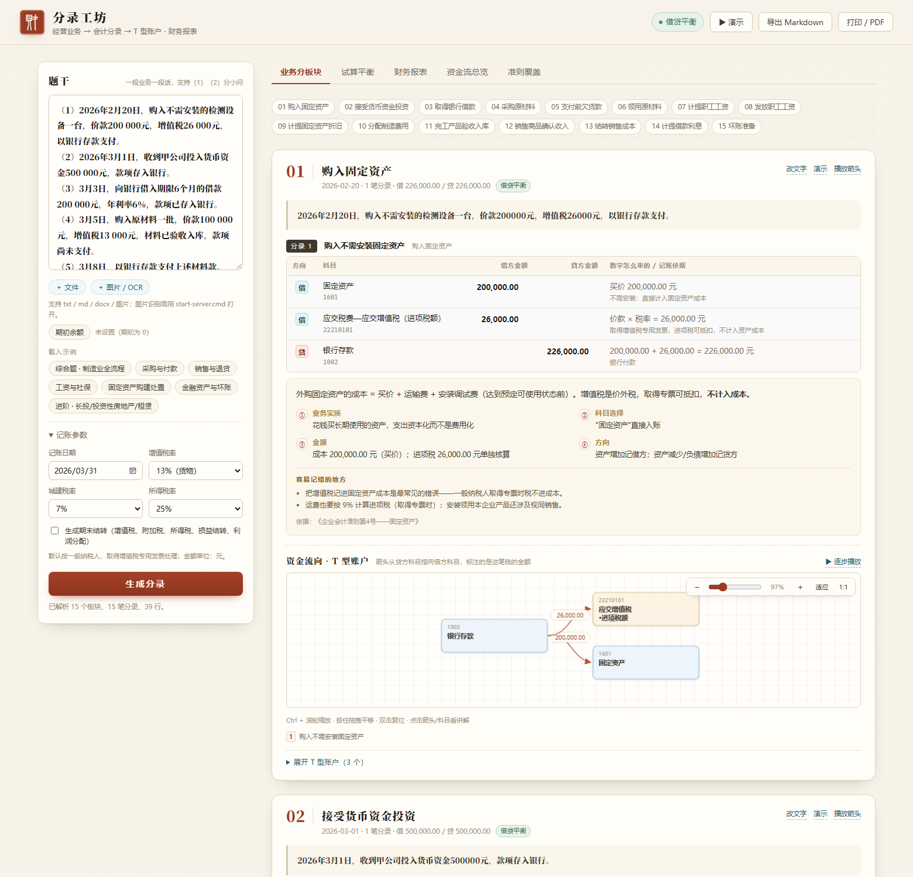

# 分录工坊 · 会计业务工作台

> ## ⚠️ 初代草稿版（v0.1 / 构建 v3.3）
>
> 这个项目还在**早期草稿阶段**，请不要把它当成成熟产品：
>
> - 运行中已经发现**部分分录的科目、金额或书写格式存在问题**，规则库与解析逻辑会继续修复；
> - 《企业会计准则》的覆盖**远未完整**（见「准则覆盖」页：已覆盖 3 号、部分覆盖 13 号、待补 26 号），后续会继续完善；
> - 目前只适合**学习、演示和讨论**，**不要用于实际记账、纳税申报或对外披露**。
>
> 发现问题欢迎开 Issue，附上题干和错误分录（最好再附书上答案），我会逐条修。这一版先作为"能跑起来的草稿"留档。

把一段公司经营业务的文字（或一张题目截图），变成**能看懂、能验算、能追溯**的会计结果：

- 自动拆成"板块（小问）→ 句子 → 业务类型"，生成**科目、借贷方向、金额**，每行都附"数字怎么来的"
- 每笔分录配四步讲解：业务实质 / 科目选择 / 金额计算 / 借贷方向，外加易错点与准则依据
- 每个板块自动生成 **T 型账户 + 带箭头的资金流向图**，支持缩放、拖拽、逐步播放
- 任何数字、任何箭头都可以**点开问"为什么"**，一键跳回对应业务
- 汇总成 **资产负债表 / 利润表 / 现金流量表**，并给出试算平衡与勾稽检查
- 公开一张 **42 号会计准则覆盖清单**，告诉你哪些已覆盖、哪些还是待补

**在线试用**：<https://xkc123456.github.io/fenlu-workbench/> （GitHub Pages，打开即用；图片 OCR 在 https 下也能直接跑）

无需安装：直接双击 `index.html` 即可（纯静态、不联网）。图片 OCR 需要本地服务，见下文。



---

## 快速开始

### 方式一：直接打开（推荐日常使用）

双击 `index.html`（Chrome / Edge）。除"图片 OCR"外全部功能可用，题目与数据都在本地，不上传任何服务器。

桌面上已生成两个快捷方式（图标为朱砂底 + 米色篆体"财"）：**分录工坊**（直接打开）与 **分录工坊 · OCR**（启动本地服务，支持图片识别）。移动项目文件夹后快捷方式会失效，删掉重建即可。

### 方式二：本地服务（需要图片 OCR 时）

双击 `start-server.cmd`（Windows）或运行 `./start-server.sh`（macOS / Linux），浏览器会自动打开 `http://127.0.0.1:8787`。

- OCR 组件（Tesseract + 中文语言包，约 8MB）已随项目放在 `vendor/`，**不联网也能识别**。
- 浏览器安全策略不允许 `file://` 页面加载 OCR 的本地 worker/wasm，所以 OCR 必须走 http。
- 关掉命令行窗口即停止服务。

### 输入方式

| 方式 | 说明 |
| --- | --- |
| 直接输入 | 小问用 `（1）`、`1.`、`①`、`第1题`、`资料一`、`【一】` 开头 |
| 导入文件 | txt / md / csv / docx（Word 正文按段落提取） |
| 拖入文件 | 把文件直接拖到题干框 |
| 图片 OCR | 截图/拍照 → 识别文字 → 可编辑后插入题干 |
| 手工分录 | `借：管理费用 5 000` / `贷：银行存款 5 000` 兜底任意业务 |

金额支持 `100000`、`100,000`、`10万元`、`壹拾万元`、`100 000`（带空格）；"上述/该批/此笔"会自动沿用上一笔金额（跨板块也有效）。

---

## 界面结构

| 区域 | 作用 |
| --- | --- |
| 业务分板块 | 每个小问一张卡：题干原文 → 分录表 → 四步讲解 → 易错点 → 资金流向图 → T 型账户 |
| 试算平衡 | 勾稽检查、试算平衡表（期初 + 发生额 + 期末余额）、利润表简表 |
| 财务报表 | 资产负债表（期初/期末）、利润表、现金流量表（教学版），附口径说明与平衡校验 |
| 资金流总览 | 每个板块的缩略资金流图 + 货币资金/存货/未交税费/未分配利润速览 |
| 准则覆盖 | 42 号准则的覆盖矩阵：已覆盖 / 部分 / 待补，以及本版具体支持的业务 |

### 期初余额

左侧「期初余额」可以补录各科目的期初数（按科目正常方向填正数，反向余额填负数），保存后：

- 试算平衡表增加**期初借方 / 期初贷方**两列，并单独校验期初借贷是否平衡；
- 资产负债表变成**期初数 / 期末数**两栏（期末 = 期初 + 本期）；
- 现金流量表的"期初现金"取期初货币资金，勾稽变成"期初现金 + 净增加额 = 期末现金"。

期初数据存在浏览器本地（localStorage），不会上传；点「清空」即可回到期初为 0。

### 演示模式

顶部「▶ 演示」或每个板块右上角「演示」进入全屏演示：

- 只保留资金流图，按分录**逐步高亮**箭头，底部可「上一步 / 下一步 / 自动播放」；
- `← →` 切步骤，`↑ ↓` 切板块，`空格` 播放/暂停，`Esc` 退出；
- 勾选「显示讲解」右侧出现这笔分录的科目、金额与"为什么这么记"；
- 支持 Ctrl+滚轮缩放、拖拽平移，右上角可切全屏。

### 分录表

- **方向**：借（青）/ 贷（朱砂），颜色贯穿全站
- **科目**：名称 + 科目代码，方便对照考试大纲
- **数字怎么来的**：算式（如 `100,000 × 13% = 13,000`）与记账依据
- **金额旁的 `?`**：鼠标移上去出现，点开是"这笔数字的来源 + 为什么这么记 + 跳到这笔业务"

### T 型账户

- 每个板块可展开 T 型账户，按"借方 / 贷方"两栏列示发生额、合计与余额方向；
- 卡片加宽到 520px 起、名称整行显示、摘要可换行，长科目名（如"应交税费—应交增值税（销项税额）"）不再被截断；
- 鼠标悬停摘要可看完整文字。

### 资金流图

- 箭头从**贷方科目**指向**借方科目**，标注这笔业务的金额，表示"价值从哪来、到哪去"
- **虚框 + 备抵**：累计折旧、坏账准备、存货跌价准备、投资性房地产累计折旧等
- **过渡**标记：制造费用、生产成本、在建工程、固定资产清理、本年利润、研发支出、应付债券—利息调整
- 右上角缩放条：`− / 滑杆 / % / + / 适应 / 1:1`，滑杆可无级缩放；也支持 **Ctrl + 滚轮**缩放、**按住拖拽**平移、**双击**复位
- 点箭头 = 看这笔业务；点科目 = 看科目定义与本板块涉及它的分录；点「▶ 播放」逐笔高亮

---

## 三张报表：能生成，但要看清口径

**能生成**：资产负债表、利润表、现金流量表，全部由本期的分录实时汇总，并做三重校验：

1. 试算平衡（借贷发生额 + 期末余额）
2. 资产负债表平衡（资产 = 负债 + 所有者权益）
3. 现金流量勾稽（净增加额 = 货币资金期末余额 − 期初）

**为什么叫"教学版"**：三张表的信息需求不一样。

| 报表 | 单题能否直接生成 | 还缺什么 |
| --- | --- | --- |
| 利润表 | ✅ 基本可以直接生成 | 几乎没有额外信息，按损益类科目发生额归集即可 |
| 资产负债表 | ✅ 可生成"期初数 / 期末数" | 录入期初后即可两栏对照；一年内到期重分类、应收/应付明细重分类、合并抵销、递延所得税口径仍需补 |
| 现金流量表 | ⚠️ 只能生成"按对方科目归类"的版本 | 每笔现金收付的**现金流量项目**需要逐笔认定（经营/投资/筹资及明细），票据贴现、非现金交易、汇率变动还要单独调整 |

所以产品里的做法是：**能算的算到底，算不了的说清楚**。未录入期初时按 0 处理，并把未结转的本期损益并入"未分配利润"以保证平衡；现金流量表按对方科目自动归类，并给出与货币资金的勾稽结果；任何科目没映射到报表项目、任何资产出现负数，都会在页面上直接提示。

要生成**对外可用的完整财报**，除了期初余额，至少还需要：科目辅助核算（客户/供应商/部门）、每笔现金流的项目标签、合并范围与抵销分录、以及税务与递延口径——这些不是"一道小题"能提供的信息。

---

## 已内置的业务规则（50+ 条）

| 场景 | 业务 |
| --- | --- |
| 筹资 | 接受货币资金/非货币资产投资（含资本溢价）、短期/长期借款、计提与支付利息、还本、发行债券（面值/溢价/折价/实际利率法）、租赁负债 |
| 采购 | 固定资产购置（需/不需安装）、安装费、在建工程转固、原材料采购（现购/赊购/预付/补付）、计划成本法（材料采购/材料成本差异）、支付欠款（含现金折扣）、开出商业汇票 |
| 生产 | 领料、工资分配、代扣个税社保、单位社保、折旧、水电等制造费用、制造费用分配、完工入库、存货跌价、无形资产摊销 |
| 销售 | 现销/赊销/预收/收票据、结转成本、收款、票据贴现、销售退回、合同负债 |
| 信用 | 坏账准备计提/转回/核销/收回 |
| 投资 | 交易性金融资产（取得/公允价值变动/处置）、其他债权投资（取得、实际利率法计息、公允价值变动计入 OCI、出售并结转 OCI）、长期股权投资（成本法/权益法：取得、损益调整、其他综合收益、股利、处置）、投资性房地产（成本模式/公允价值模式）、固定资产处置 |
| 租赁 | 承租方：使用权资产/租赁负债初始确认、折旧、利息、支付租金 |
| 研发 | 费用化/资本化研发支出、开发支出转无形资产 |
| 其他 | 固定资产减值、政府补助（与收益/资产相关） |
| 期末 | 城建税及附加、转出未交增值税、缴纳增值税、所得税、结转收入/费用、结转本年利润、提取盈余公积、宣告股利 |

**期末自动结转**顺序：转出未交增值税 → 城建税及附加 → 所得税 → 结转收入 → 结转费用 → 本年利润 → 未分配利润 → 提取法定盈余公积 → 结平利润分配明细。

---

## 准则覆盖：不是"全都做完了"

会计准则共 42 号，每号下面还有大量具体交易。"完整纳入"是一个持续工程，所以产品把进度**公开成一张表**（「准则覆盖」页）：

- **已覆盖 3 号**：存货、固定资产、职工薪酬
- **部分覆盖 13 号**：长期股权投资、投资性房地产、无形资产、资产减值、收入、政府补助、借款费用、所得税、租赁、金融工具、公允价值、财务报表列报、现金流量表
- **待补 26 号**：生物资产、非货币性资产交换、股份支付、债务重组、或有事项、外币折算、企业合并、合并报表、每股收益……

这张表同时是路线图：规则库按号补充，新增一类业务就更新一行。你如果告诉我"先补哪几号"，我就按那个顺序做。

---

## 准确性如何保证

1. **解析可追溯**：金额带标签（价款/增值税/运费/售价/成本…）与来源句子，算式直接显示在分录行。
2. **逐笔平衡校验**：任何一笔分录不平会立刻标红；全题再做一次试算平衡。
3. **勾稽检查**：增值税（销项−进项）、利润总额、银行/现金负余额、未识别业务、报表平衡差。
4. **可修正**：每个板块可「改文字」只重算这一块；也可以直接用手工分录补。
5. **测试**：`node tests/smoke.js` 跑全部示例，逐笔校验平衡、未识别业务、期末结转、三张报表平衡与现金流勾稽。

```
cd accounting-workbench
node tests/smoke.js
```

---

## 目录结构

```
accounting-workbench/
├─ index.html
├─ start-server.cmd / .sh    本地服务（OCR 用）
├─ assets/
│  ├─ app.css
│  └─ seal-cai.png           篆体"财"印章
├─ src/
│  ├─ core.js                科目表、金额解析、中文数字
│  ├─ rules/
│  │  ├─ helpers.js
│  │  ├─ advanced.js         计划成本/长投/投资性房地产/租赁/债券/研发/减值/补助
│  │  ├─ fund.js             筹资
│  │  ├─ buy.js              采购与付款
│  │  ├─ produce.js          生产与成本
│  │  ├─ sell.js             销售、票据、坏账
│  │  ├─ invest.js           金融资产、固定资产处置
│  │  ├─ period.js           税费、结转、利润分配
│  │  └─ index.js            规则注册（顺序 = 优先级）
│  ├─ parse.js               分板块/分句/取数/跨句上下文
│  ├─ engine.js              总账、试算平衡、期末结转、勾稽
│  ├─ reports.js             资产负债表/利润表/现金流量表
│  ├─ coverage.js            准则覆盖矩阵
│  ├─ flow.js                资金流图布局与 SVG
│  ├─ import.js              文件导入、docx 解压、图片 OCR
│  ├─ examples.js
│  └─ app.js                 界面与交互
├─ vendor/                   本地 OCR（Tesseract + chi_sim）
└─ tests/smoke.js
```

### 加一条新规则

在对应 `rules/*.js` 追加：

```js
{
  id: 'rent-prepaid',
  title: '预付租金',
  scene: '费用',
  test: (t) => /预付/.test(t) && /租金/.test(t),
  build(ctx) {
    const amt = ctx.a.amount || 0;
    return [E(ctx, '预付全年租金', [
      d('1123', amt, `预付 ${fmt(amt)} 元`, '先付后受益，属于资产'),
      c('1002', amt, `银行付款 ${fmt(amt)} 元`, '银行存款减少')
    ], explain('……', [['业务实质', '……']], ['……'], '《企业会计准则》'))];
  }
}
```

金额参数 `ctx.a` 有 `price / vat / freight / total / amount / rate / cost / fee`；`ctx.bal(code)` 读当前累计余额（用于"按余额结转"）；`ctx.prev` 是上一句金额；`ctx.recent` 是最近几句原文（用于"采用权益法"这类跨句上下文）。

---

## 已知问题与路线图（草稿版）

**已发现、待修复：**

- 部分业务的分录书写仍需校正，尤其是：金融资产三分类（交易性金融资产 / 其他债权投资 / 债权投资）、计划成本法的差异分摊、租赁的利息与折旧、债券溢折价的逐期摊销、视同销售与债务重组等；
- 个别分录的科目或金额在特定表述下会出错，部分题干会被判为"未识别"；
- 准则覆盖不完整：42 号准则中还有 26 号待补（合并报表、股份支付、债务重组、外币折算等）；
- 报表是教学口径：期初余额已支持，但一年内到期重分类、合并抵销、递延所得税、现金流量项目逐笔认定仍未完成；
- OCR 对拍照/手写识别率有限，需要人工核对。

**下一步：**

- v0.2：逐条对照教材例题修分录，补成可回归的测试用例（`tests/`）；
- v0.3：继续补准则（优先合并报表、股份支付、债务重组、外币折算），并更新「准则覆盖」页；
- v0.4：现金流项目标签、报表口径与导出（Word/PDF）；
- 长期：解析从"关键词规则"升级为"规则 + 语义模型兜底"，降低对教材式表述的依赖。

**当前版本**：v0.1（界面构建号 v3.3）。如果你在运行中发现具体哪笔分录不对，欢迎开 Issue 附上题干与书上答案。

---

## 隐私与边界

- 所有解析、记账、报表、OCR **都在本地完成**，不上传题目或图片。
- 默认**一般纳税人 + 取得增值税专用发票**；小规模纳税人、普票不可抵扣尚未做分支。
- 成本按**实际成本法**（另有计划成本法），未实现品种法/分批法/分步法的成本分配。
- 报表为教学口径，不能直接用于纳税申报或对外披露。
- 解析基于关键词与业务规则：题干越接近教材标准表述，识别越准；识别不到会明确标出并用「改文字」或手工分录兜底。
- 本工具用于教学与练习，不能替代执业判断。
